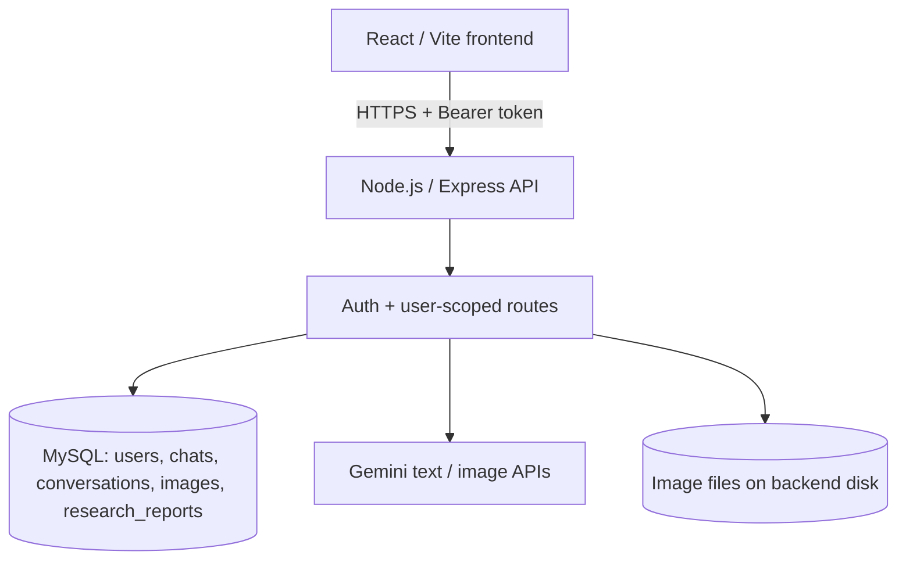

# ChatGPT Clone — Full-Stack AI Application

**React 19 · Vite 8 · Node.js · Express 4 · MySQL · Gemini API**

A ChatGPT-inspired, authenticated AI web application with conversational chat history, image generation, built-in AI mini-apps, and saved Deep Research reports. This repository retains the existing chat interface and uses an MVC-style backend (routes → validation → controllers → services → database/provider).

> **Release status:** The application source is provided as the final project candidate. Production operation still depends on passing the live deployment checks in [docs/DEPLOYMENT.md](docs/DEPLOYMENT.md). In particular, the supplied MySQL driver configuration needs TLS support before connecting to Aiven with certificate verification; generated images require persistent storage; and long-running research currently executes within the web server process. These are documented deployment requirements, not completed tests.

## Features

| Area | Implementation | Status in this repository |
| --- | --- | --- |
| Account registration and sign-in | Email/password, scrypt password hashes, signed Bearer tokens | Implemented |
| Chat | Multiple user-scoped threads, message history, rename/delete, Gemini responses | Implemented |
| Images | Gemini image generation, private image gallery, authenticated image download/delete | Implemented; model access and durable disk needed |
| Apps | Translator, Summarizer, Email Writer, Study Quiz, Rewrite and Fix, Recipe Maker | Implemented, Gemini-backed |
| Deep Research | Multi-step report generation, progress polling, optional Google Search grounding, saved reports | Implemented; in-process jobs |
| Themes and layout | Responsive, ChatGPT-inspired sign-in and chat interface; light/dark chat theme | Implemented |
| Codex and Projects | Sidebar entries | **Navigation placeholders only**; no working APIs in this version |

**Apps are built-in prompt-based tools**, not third-party integrations with Gmail, Google Drive, etc. Research may fall back to model knowledge if Google Search grounding is unavailable, and explicitly labels that limitation in its report.

## Architecture



The frontend **never** connects to MySQL or Gemini directly. The server stores secrets in environment variables. The UI stores the access token in browser `sessionStorage`; the token currently expires after 24 hours.

## Repository layout

```text
chatgpt-clone/
├── README.md
├── docs/
│   ├── DEPLOYMENT.md          # Aiven → Render → Vercel, release checklist
│   ├── API_REFERENCE.md       # Auth, Chat, Images, Apps, Research routes
│   └── TROUBLESHOOTING.md     # Diagnostics, recovery, operations
├── backend/
│   ├── .env.example
│   ├── index.js
│   ├── package.json
│   ├── db/
│   │   ├── db.config.js
│   │   └── schema.sql         # One unified schema; five tables
│   └── src/
│       ├── api/
│       │   ├── auth/{controller,service,validation,auth.routes.js}
│       │   ├── chat/{controller,service,validation,chat.routes.js}
│       │   ├── images/{controller,service,validation,images.routes.js}
│       │   ├── apps/{controller,service,validation,apps.routes.js}
│       │   ├── research/{controller,service,validation,research.routes.js}
│       │   └── main.routes.js
│       ├── middleware/
│       └── services/ai.service.js
└── frontend/
    ├── .env.example
    ├── package.json
    ├── vite.config.js
    └── src/
        ├── App.jsx
        ├── api.js
        ├── api/{authApi,chatApi}.js
        ├── components/Auth/
        └── views/{ImagesView,AppsView,ResearchView}/
```

## Requirements

- **Node.js 22.12+ or 24 LTS** and npm (the frontend uses Vite 8; `backend/package.json` declares Node >=20).
- MySQL 8-compatible server (local MySQL/MAMP/XAMPP or cloud Aiven MySQL).
- MySQL Workbench (recommended for creating/verifying tables).
- A Gemini API key with permission to use your configured text model. The image-generation model may need a billed API project.
- Git/GitHub for hosted deployment.

## Quick start in VS Code (local)

1. **Create the database.** In MySQL Workbench, connect to your real MySQL server, open `backend/db/schema.sql`, and execute it. This creates the `chatgpt_clone` database and the five tables on a fresh server. **Back up an existing database first**: `CREATE TABLE IF NOT EXISTS` is not a migration tool.
2. **Set backend environment variables.** Copy `backend/.env.example` to `backend/.env` and replace all placeholders with actual values. In Git Bash:

   ```bash
   cp backend/.env.example backend/.env
   ```

   Important names: `DB_NAME` (not `DB_DATABASE`) and `FRONTEND_ORIGIN` (not `CORS_ORIGIN`). Generate a random `JWT_SECRET` using:

   ```bash
   node -e "console.log(require('node:crypto').randomBytes(48).toString('hex'))"
   ```

   Preserve an existing working JWT secret if you need to keep current sign-in sessions valid.

3. **Start backend** in terminal 1:

   ```bash
   cd backend
   npm ci
   npm run dev
   ```

4. **Start frontend** in terminal 2:

   ```bash
   cd frontend
   npm ci
   npm run dev
   ```

5. Visit **http://localhost:5173**. Register or sign in and send a test chat message. The dev proxy routes `/api` to `http://127.0.0.1:3777`.

**Local API health:** http://localhost:3777/api/health. Expected successful JSON includes `"success": true`. Health checks verify the HTTP server, not Gemini access or database write functionality.

## Environment variables

### Backend (`backend/.env`)

| Variable | Required / meaning | Local example |
| --- | --- | --- |
| `PORT` | Express port; Render sets `PORT` automatically | `3777` |
| `FRONTEND_ORIGIN` | Allowed browser origin(s), comma-separated | `http://localhost:5173` |
| `DB_HOST` | MySQL hostname | `127.0.0.1` |
| `DB_PORT` | MySQL port; use the actual Aiven port in cloud | `3306` |
| `DB_USER` | MySQL username | your account |
| `DB_PASSWORD` | MySQL password | **secret** |
| `DB_NAME` | Must match the SQL database | `chatgpt_clone` |
| `JWT_SECRET` | Random secret ≥32 bytes; keep stable between redeployments | **secret** |
| `AI_PROVIDER` | `gemini` for all AI features | `gemini` |
| `GEMINI_API_KEY` | Server-side Gemini API key | **secret** |
| `GEMINI_MODEL` | Gemini text model for chat, apps, research | `gemini-flash-latest` |
| `GEMINI_FALLBACK_MODEL` | Optional chat fallback model; may be left empty | empty |
| `GEMINI_MAX_ATTEMPTS` | Chat primary model retry count, clamped to 1–5 | `3` |
| `GEMINI_IMAGE_MODEL` | Gemini image model ID | `gemini-3.1-flash-image` |

The chat service also supports optional **OpenAI text mode** via `AI_PROVIDER=openai`, `OPENAI_API_KEY`, `OPENAI_MODEL`, and `OPENAI_API_URL`; this does **not** replace Gemini for Images, Apps, or Deep Research. For a consistent deployment, stay with `AI_PROVIDER=gemini`.

### Frontend (`frontend/.env`)

```dotenv
# Local Vite proxy:
VITE_API_BASE_URL=/api
```

For Vercel, use **`https://YOUR-RENDER-SERVICE.onrender.com/api`**, including the **`/api` suffix**, and rebuild the frontend. Values starting with `VITE_` are public in the browser bundle; **never put keys or passwords there**.

## Commands

| Directory | Command | Action |
| --- | --- | --- |
| `backend/` | `npm ci` | Install locked backend dependencies |
| `backend/` | `npm run dev` | Run backend with Node watch mode |
| `backend/` | `npm start` | Run backend for production |
| `frontend/` | `npm ci` | Install locked frontend dependencies |
| `frontend/` | `npm run dev` | Run Vite dev server |
| `frontend/` | `npm run build` | Compile production frontend into `dist/` |
| `frontend/` | `npm run preview` | Locally preview the built frontend |
| `frontend/` | `npm run lint` | Run ESLint |

There is intentionally **no `backend/scripts/` folder** and no database setup npm command; use `backend/db/schema.sql` in Workbench.

## Database

The single schema file is `backend/db/schema.sql`, defining:

- `users` — account profile and password hashes.
- `chats` — one user's named conversation threads.
- `conversations` — user and assistant messages associated with chats.
- `images` — per-user image metadata; actual bytes stored under `backend/uploads/images`.
- `research_reports` — per-user research status, progress, report, and sources.

Useful verification:

```sql
USE chatgpt_clone;
SHOW TABLES;
SELECT COUNT(*) AS users_count FROM users;
SELECT COUNT(*) AS chats_count FROM chats;
```

## API overview

The API root is **`/api`**. Except for `/api/health`, registration, and login, all endpoints require `Authorization: Bearer <accessToken>`.

| Area | Examples |
| --- | --- |
| Health | `GET /api/health` |
| Auth | `POST /api/auth/register`, `POST /api/auth/login`, `GET /api/auth/me` |
| Chat | `GET/POST /api/chat/threads`, `GET/POST /api/chat/threads/:threadId/messages` |
| Images | `GET/POST /api/images`, `GET /api/images/:id/file`, `DELETE /api/images/:id` |
| Apps | `GET /api/apps`, `POST /api/apps/:appId/run` |
| Research | `GET/POST /api/research`, `GET /api/research/:id`, `DELETE /api/research/:id` |

See [API reference](docs/API_REFERENCE.md) for request shapes and test examples.

## Deploy

Read **[Production Deployment Guide](docs/DEPLOYMENT.md)** before uploading code. The guide covers:

1. Secret scanning and GitHub push
2. Dedicated Aiven MySQL database and TLS/certificate setup
3. Render backend settings and startup checks
4. Vercel frontend settings and CORS
5. Persistent image storage and research-job reliability
6. End-to-end smoke tests, release checklist and rollback

Also see [Troubleshooting & Operations](docs/TROUBLESHOOTING.md).

## Security and operational notes

- Never commit `.env` files, credentials, session tokens, database exports, or generated image files. The root `.gitignore` excludes these paths.
- CORS restricts browser origins; it is **not authentication**. All private APIs use Bearer-token verification and ownership checks.
- Current token storage is `sessionStorage` and tokens expire after 24 hours. Evaluate stronger session protections, recovery and password-reset flows for a widely used public service.
- The built-in rate limiters are **in memory**. For multi-instance deployment, move to shared storage.
- Images require a persistent filesystem or object storage; without it, database rows can outlive missing files after a restart.
- Research runs as an in-process background promise. A restart interrupts running reports; use a durable job worker/queue for high-availability production workloads.
- Public-facing launch is **not certified** by documentation alone: complete the live acceptance checklist first.

## Attribution

This is an independent educational ChatGPT-inspired project, **not an official OpenAI or ChatGPT service**. Third-party APIs and hosted infrastructure have their own terms, usage limits and billing.

## License

No license was provided with this project. Add one only if the repository owner chooses to license the code.
